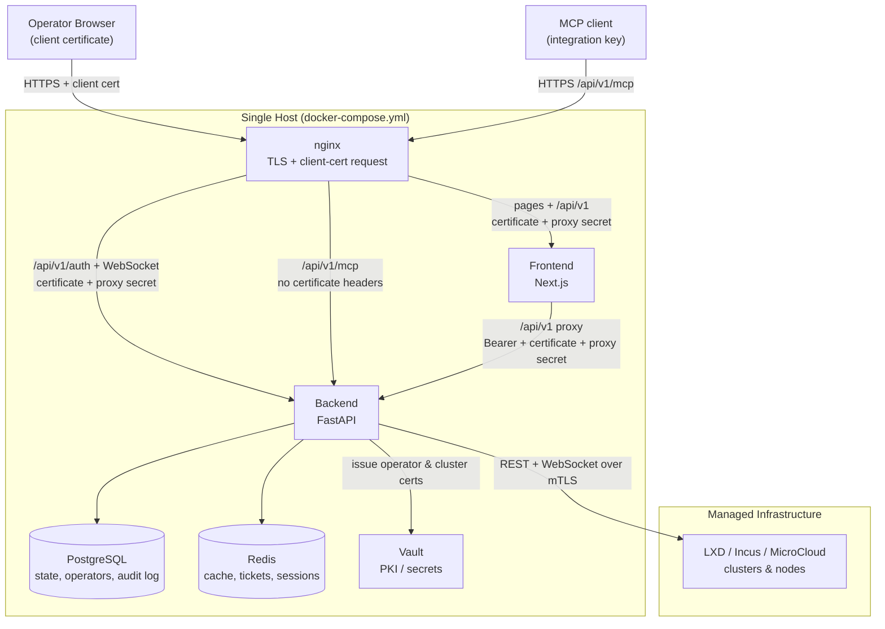

# Architecture

Orcastra Mini runs every service on a single host with Docker Compose. The only port
published to the host is the nginx HTTPS port; the frontend, backend, and Vault are reachable
only on the internal Docker network (Vault is additionally bound to loopback).

## Topology

## Request path

1. The browser connects to nginx over HTTPS and presents its imported client certificate.
2. nginx terminates TLS and requests the certificate (`ssl_verify_client optional_no_ca`,
   trust-on-first-use). On every request it overwrites the `X-SSL-Client-Cert`,
   `X-SSL-Client-Verify` and `X-SSL-Client-S-DN` headers from the TLS layer and adds
   `X-Auth-Proxy-Secret` (the shared `AUTH_PROXY_SECRET`). nginx keeps no TLS session cache, so
   each new connection presents the browser's current certificate.
3. nginx routes by path:
    - `/api/v1/auth/*` goes straight to the backend: the sign-in status read, certificate sign-in
      and first-administrator enrollment.
    - `/api/v1/mcp` goes to the backend with the certificate headers and the proxy secret blanked:
      MCP clients authenticate with integration keys, never certificates.
    - WebSocket upgrades (consoles, terminals, feeds) go straight to the backend, with the
      certificate headers and the secret. Socket URLs carry single-use tickets, which nginx keeps
      out of its access log.
    - Everything else goes to the frontend.
4. To sign in, the frontend's NextAuth Credentials provider checks the proxy secret and sends the
   certificate to the backend (`/api/v1/auth/cert-login`). The backend computes the certificate's
   SHA-256 fingerprint, finds the operator it belongs to and their role, and mints a short-lived
   session token (HS256) bound to that certificate.
5. Every other API call carries the session token as `Authorization: Bearer` and reaches the
   backend through the frontend's API proxy. The proxy forwards nginx's copy of the certificate
   with the proxy secret, after dropping any certificate headers the browser sent. The backend
   accepts the token only when the request presents the certificate the token names.

!!! note "Why a token bridge"
    Only the source of the token changes between the two editions. The certificate is verified
    at sign-in and exchanged for a session token bound to it; the rest of the application (RBAC,
    bearer tokens, WebSockets) is the same as in the full version, which keeps the blast radius
    small.

## Components

| Service | Role | Host exposure |
|---|---|---|
| nginx | TLS termination, requests the client certificate, routes by path, single entry point | Published (`HTTPS_BIND`:`HTTPS_PORT`, default `0.0.0.0:6969`) |
| Frontend (Next.js) | UI, the certificate sign-in bridge, and the API proxy | Docker network only |
| Backend (FastAPI) | API, RBAC, operators and certificate issuance, audit, LXD/Incus driver | Docker network only |
| PostgreSQL | Application state, operators and their certificates, the audit log | Docker network only |
| Redis | Cache, and the tickets and sessions the backend workers share | Docker network only |
| Vault | PKI for operator and cluster certificates, secret storage | Loopback only (`127.0.0.1:8200`) |
| autoheal | Restarts the backend, frontend or nginx when Docker marks it unhealthy; no network | None |

## Ports

| Service | Port | Exposure |
|---|---|---|
| nginx (HTTPS) | `6969` | Published to the host on `HTTPS_BIND` (the only public port) |
| Frontend | `2025` | Docker network only |
| Backend | `4050` | Docker network only |
| Vault | `8200` | Loopback only (`VAULT_HOST_PORT`) |

The public port is set with `HTTPS_PORT` in `.env`, and the address it listens on with
`HTTPS_BIND`. Choose a port that does not collide with other services on the host (for example,
the LXD UI uses 8443).

## Security model

- **Header trust boundary.** nginx overwrites the `X-SSL-*` headers from the real TLS layer,
  so a browser cannot forge them. The frontend and the backend honour those headers only when
  the shared `AUTH_PROXY_SECRET` arrives with them (and, optionally, the caller is inside
  `TRUSTED_AUTH_PROXY_CIDRS`). The frontend's API proxy drops any copy a browser sends and
  forwards only nginx's, and the backend port is never published.
- **Identity from the fingerprint.** The backend computes the SHA-256 fingerprint of the
  presented certificate and finds the operator it belongs to. The role comes from the
  operator's record, never from the certificate subject, so a self-signed `CN=admin` cannot
  escalate.
- **Sessions bound to the certificate.** A session token carries the thumbprint of the
  certificate it was minted for (`cnf.x5t#S256`, RFC 8705), and every request and WebSocket must
  present that certificate. A copied token is useless without the certificate's private key.
- **Revocation at the application layer.** `optional_no_ca` does not consult a CRL, so every
  request re-reads the operator from PostgreSQL (cached for up to two seconds per worker). A
  revoked, deleted or role-changed operator, or a revoked certificate, is refused on the next
  request regardless of the token's own lifetime, and open WebSockets close within a minute.
  If the store cannot be read, the request is refused.
- **No default-grant.** An authenticated certificate that maps to no active operator is denied,
  not treated as a tenant.
- **MCP without certificates.** `/api/v1/mcp` reaches the backend with the certificate headers
  and proxy secret blanked; MCP clients authenticate with integration keys.
- **Tamper-evident audit.** The audit log is append-only and hash-chained;
  `/api/v1/audit-log/verify` recomputes the chain and also detects rows deleted from the end
  against a stored high-water mark.

See [Certificate Authentication](certificate-auth.md) for the enrollment and session details,
and [Operations](operations.md) for verifying the audit chain.
